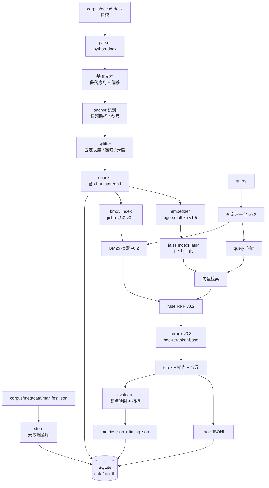

# 架构设计

## 1. 整体形态

**单进程、确定性流水线、无 LLM 参与运行时决策**（D-001）。同一 `query + config + 索引` 必得同一结果，评测回路不发起任何网络请求。

| 版本 | 进程形态 | 对外形态 |
| --- | --- | --- |
| v0.1~v0.3 | 单一 Python 进程，命令行入口 | `python -m src.cli.ingest` / `python -m src.cli.eval` |
| v0.4 | 单进程 + FastAPI（Uvicorn，端口 8000） | 4 个 HTTP 接口 |
| v0.5 | 增加 Streamlit（端口 8501）与 `/ask` 生成层 | 单页演示 + 生成接口 |

## 2. 组件与数据流



数据流的四个硬约束：

1. **只读输入**：`corpus/**` 只读；解析产物一律落 `data/` 与 `.cache/`。
2. **偏移不可变**：chunk 只存基准文本偏移（5.3.2），任何归一化都不得改变偏移语义。
3. **单一写入点**：trace 只写 JSONL，SQLite 的 `traces` 表由导入命令生成，避免双写不一致；`documents` / `chunks` / `runs` 由 ingest 与 eval 在事务内写。
4. **可复现**：`run_id` 由规范串哈希生成、不含日期（见 `06-schemas/README.md` §3）；产物按 `data/runs/<run_id>/attempt-N/` 组织，复现验证比对两次 attempt 的 `metrics.json`。

## 3. 分层与依赖方向

```
cli / api / ui        ← 入口层，只做参数解析与输出格式化
    ↓
usecases              ← ingest / search / evaluate 编排
    ↓
domain                ← parser, anchor, splitter, embedder, fuse, rerank, metrics
    ↓
infra                 ← store(SQLite), index(faiss/bm25), trace(JSONL), config
```

依赖单向向下，**禁止 domain 直接 import cli/api**，禁止 infra 反向依赖 usecases。变更影响分析按此方向判断：改 infra 只影响上层调用点，改 domain 契约影响全部用例。

## 4. 外部依赖

| 依赖 | 性质 | 版本策略 | 失效影响 |
| --- | --- | --- | --- |
| `python-docx` | 解析库，本地 | 锁文件固定 | 无法解析语料 |
| `sentence-transformers` + `torch` | 本地推理 | 锁文件固定 | 无法建索引与检索 |
| 模型权重 `BAAI/bge-small-zh-v1.5` | 本地文件（HF_HOME） | 版本写入 `run_id` | 需重新下载，指标不可比 |
| `faiss-cpu` | 本地索引 | 锁文件固定 | 退化为 numpy 检索（需变更单） |
| `jieba` / `rank_bm25` | 本地分词与稀疏检索（v0.2） | 锁文件固定 | 无法跑混合检索 |
| `BAAI/bge-reranker-base`（v0.3） | 本地推理，约 1.04GB | 版本写入 `run_id` | 关闭 rerank，返回融合排序 |
| 云端 LLM（v0.5，可选） | 外部 API | 环境变量 | `/ask` 不可用，检索不受影响 |

无第三方检索服务、无云端向量库、无鉴权服务。v0.5 的 LLM 是唯一外部调用，且不参与任何指标（REQ-051）。

## 5. 规模与资源边界

| 项 | 边界 | 超出后的动作 |
| --- | --- | --- |
| 文档数 | 数千篇以内（当前 150 篇） | 换 IVF/HNSW 索引，评估分片 |
| chunk 数 | 十万以内（v0.1 实测 34；v0.2 全量实测 **2704**，基准文本 1,191,197 字） | 同上，并引入批量写入 |
| 内存 | < 4GB（含模型权重约 1.1GB） | 降 batch size 或换小模型（走选型单） |
| 并发 | 个位数 | 加 Uvicorn worker，索引只读共享 |
| 延迟 | 无 SLA；p50/p95 实测入 B6 表 | 调 top-k 与 rerank 候选数 |

## 6. 版本演进切面

| 版本 | 架构增量 | 不改动 |
| --- | --- | --- |
| v0.1 | 解析 → 固定切分 → 向量 → 评测 | — |
| v0.2 | 加 BM25、RRF、trace；语料扩至 150 篇（CHG-002） | 偏移基准、指标定义、`run_id` 结构 |
| v0.3 | 加三种切分、父子 chunk、标题路径注入、rerank、bootstrap | 同上 |
| v0.4 | 加 API 层、元数据过滤、三条降级、增量入库、CI | 同上 |
| v0.5 | 加 Streamlit、`/ask`、引用校验 | 检索链路与指标 |

## 7. 关键取舍

- **不用 LangChain 等高层封装**：切分与检索机制要能逐行讲清，封装会隐藏边界行为。
- **父子 chunk 只索引 child**：定位精度由 child 保证，返回语义完整性由 parent 保证；评测统一映射到 parent 锚点，避免同一 parent 的多个 child 重复计分。
- **过滤优先后置**：小库用「先取较大 top-k 再后置过滤」，避免 FAISS 的 `IDSelector` 在最内层循环查表；过滤成为核心需求时才换支持原生过滤的向量库。
- **trace 单写 JSONL**：SQLite 表是派生物，避免两处写入不一致。
