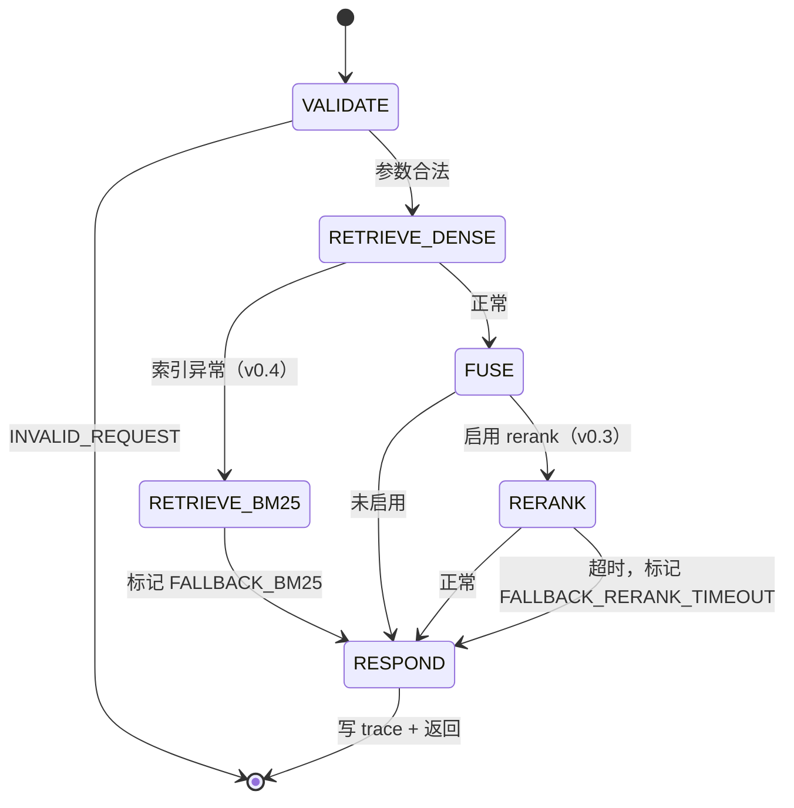
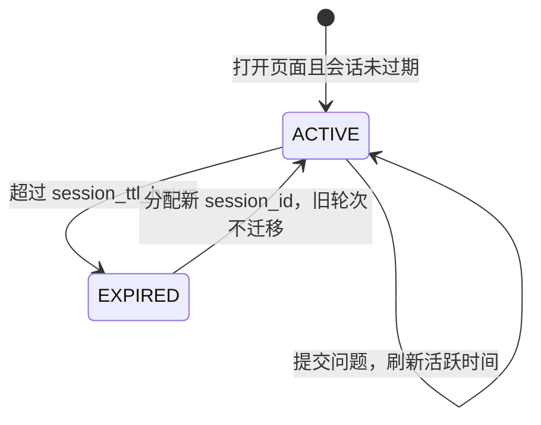
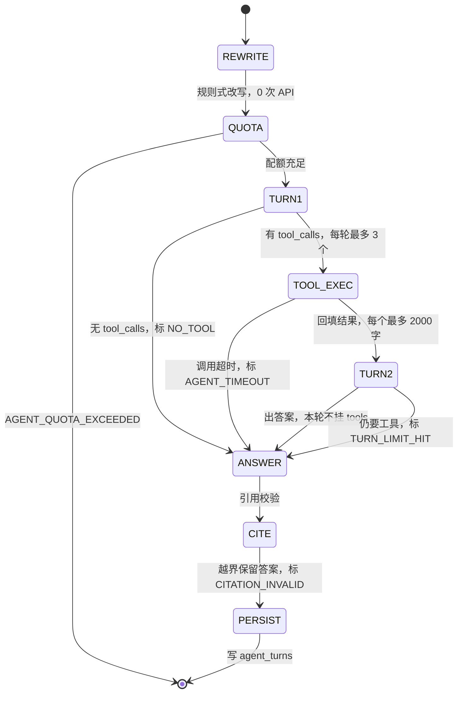

# 状态与数据流

## 1. 记忆策略

**v1 不存会话记忆，无失效策略**（D-002 / P1#9）。

- `f(query, config, 索引)` 为纯函数：同一输入恒得同一输出（REQ-021）。
- 系统里存在的三类「历史」都不参与下一次决策：`data/trace.jsonl`（只读分析）、`runs` 表（实验记录）、`data/index/`（索引产物，命中即返回同一结果）。
- 跨会话记忆与多轮问答自 v2 起由**问答 Agent 层**提供（`CHG-013`，2026-11-22 落地），检索与评测路径仍无状态，见 §6、§7。

## 2. 单次查询状态机

状态转移全在代码中固定，无模型决策。每一步的失败处理见 `11-errors.md`。

## 3. 阶段数据契约

| 阶段 | 输入 | 输出 | 持久化 | 版本 |
| --- | --- | --- | --- | --- |
| VALIDATE | 请求参数 | 校验后参数 | 无 | v0.1 |
| PARSE | DOCX 路径 | 基准文本、段落序列、元数据 | `documents` | v0.1 |
| SPLIT | 基准文本 + 段落序列 | chunk 列表（含偏移） | `chunks` | v0.1 |
| EMBED | chunk 文本 | 归一化向量 | `data/index/faiss.idx` | v0.1 |
| RETRIEVE_DENSE | query 向量 | `[(chunk_id, score)]` | 无（进 trace） | v0.1 |
| RETRIEVE_BM25 | 分词后 query | `[(chunk_id, score)]` | 无（进 trace） | v0.2 |
| FUSE | 两路排名 | 融合排序 | 无（进 trace） | v0.2 |
| RERANK | 融合后 top-N | 重排结果 | 无（进 trace） | v0.3 |
| RESPOND | 排序结果 | 响应体 | `data/runs/<run_id>/` | v0.1 |
| EVAL | 评测集 + 检索结果 | 指标 | `metrics.json` + `runs` | v0.1 |

## 4. trace 字段

每行一条 JSON（`data/trace.jsonl`），字段固定，只增不改：

| 字段 | 类型 | 说明 | 版本 |
| --- | --- | --- | --- |
| `run_id` | str | 本次运行标识 | v0.2 |
| `case_id` | str \| null | 评测用例编号；手工查询为 null | v0.2 |
| `query_raw` | str | 原始查询 | v0.2 |
| `query_norm` | str | 归一化后查询 | v0.3 |
| `dense` | list | `[{chunk_id, score, rank}]`，前 top-N | v0.2 |
| `bm25` | list | 同上 | v0.2 |
| `fused` | list | 融合后顺序 | v0.2 |
| `reranked` | list | 重排后顺序 | v0.3 |
| `hit_chunk_id` | str \| null | 命中的 gold 所在 chunk | v0.2 |
| `hit_rank` | int \| null | 命中排名，未命中为 null | v0.2 |
| `excerpt` | str | 命中 chunk 前 80 码点（D-009） | v0.2 |
| `latency_ms` | dict | 各阶段耗时；落表时序列化为 `traces.latency_json` | v0.2 |
| `flags` | list | `FALLBACK_*` / `FILTER_RELAXED` | v0.4 |

**不写入**：完整原文、密钥、绝对路径中的用户目录、模型权重路径。

### 4.1 trace 的读取路径

| 用途 | 读什么 | 说明 |
| --- | --- | --- |
| 明细分析、失败案例归类 | `data/trace.jsonl`（**权威**） | `eval.py` 与失败案例归因直接读 JSONL，按 `run_id` 过滤，不经 SQLite |
| SQL 聚合、`/trace` 摘要 | `traces` 表（派生） | 由 `cli/import_traces.py` 从 JSONL 导入，记 `source_run_id` 与 `imported_at`；只存摘要字段 |
| 复现比对 | `data/runs/<run_id>/attempt-N/metrics.json` | 与 trace 无关，避免把日志当结果 |

写入方式：追加写，一行一条 JSON，字段只增不改。默认单进程写（CLI 单进程）；若并发写，用标准库平台文件锁（POSIX `fcntl.flock` / Windows `msvcrt.locking`）包住整行写入，**不新增依赖**。JSONL 与 `traces` 表允许短暂不一致，导入命令幂等重跑即可对齐。

## 5. 中断与恢复

| 场景 | 行为 |
| --- | --- |
| ingest 中途失败 | 单事务回滚，不留半批数据；失败条目写 `ingest_log`（v0.4） |
| 索引文件缺失但 DB 有 chunk | 报 `INDEX_EMPTY`，提示重建；不自动重建（避免误覆盖） |
| eval 中途中断 | 该 attempt 目录缺少 `metrics.json` 即为无效运行；`runs.metrics_json` 不更新 |
| 同一 `run_id` 重跑 | **不覆盖旧结果**：新开 `data/runs/<run_id>/attempt-N/`，`runs.metrics_json` 记最后一次 attempt；其余行幂等（REQ-048） |
| 复现验证 | 同 `run_id` 连跑两次 → `attempt-1/` 与 `attempt-2/`，逐字节 diff 两份 `metrics.json`；`run_id` 不变 |
| 需要并列保留多份结果 | 人工给 `run_id` 加 `-2`、`-3` 后缀；该后缀不参与复现判定 |
| 模型权重缺失 | 首次加载自动下载到 `HF_HOME`；离线环境报明确错误，不静默降级 |

## 6. v2 记忆隔离约束（已落地，不可违反）

依据：`CHG-013`（2026-11-22 确认，S1~S5 落地）；技术方案 §7.3 为本节来源。落地状态逐条对应如下。

1. 记忆只作用于多轮问答层；`/search`、`/eval`、CI 回归永远无状态。
   - 落地：会话数据只写 `agent_sessions`／`agent_turns`；`/search`、`/eval`、`scripts/ci_check.py` 均不读这两张表。
2. `stateless_mode` 在**响应字段**与 `agent_sessions.stateless_mode` 列声明，评测恒为 `true`；**不进 `run_id` 规范串**（D1）。
   - 技术方案 §7.3 原文写「`run_id` 增加 `stateless_mode=true`」，差异按 `CHG-013` §8.1 追溯：`run_id` 是「配置指纹」，用于判断结果可比性；把「这轮有没有开记忆」混进同一哈希，会让「换配置」与「加开关」落成同一个 id，还要额外付一次基线重定（`evals/baseline.json`、快照表、检查单 C-06）与一次 CI 红。保留原目的（声明评测路径无状态），替换实现手段。
   - 现状：基线仍 `r31a95a0e1de6`，六项指标 0.5600／0.8600／0.9000／0.7045／0.7543／0.9000 不变。
3. 最小实现：会话 id + SQLite 存 `(query, top_k, 选中 chunk)` + 规则式指代替换，0 次 API。
   - 落地：`agent_turns` 存 `query_raw`／`query_rewritten`／`rewrite_rule`／`tool_calls_json`／`answer`／`citations_json`／`flags`；改写为纯函数（代词表 + 上一轮问句 + 相对年份替换），不调模型、不读网络，规则名落库可查。
4. 评测重建：样本从「单条 query + gold 锚点」变为「对话串 + 每轮锚点」，按会话切分 holdout。
   - 现状：**未立项**（D5），按技术方案 §7.3 约束 3 单独立项；本版评测集与指标口径不变，`evals/cases.csv` 未动。
5. 新增记忆属架构与能力边界变更，走变更单、更新本文件、重新过 G2。
   - 落地：`CHG-013`（架构 + 能力边界），本文件随之更新；`config.yaml` 新增 `agent` 段 8 项与 `server.ui_port_agent`。

## 7. v2 问答会话状态机（`CHG-013`，2026-11-22 落地）

### 7.1 会话生命周期

- **读时判定**（D2）：`open_session` 比对 `last_active_at` 与 `agent.session_ttl_hours`（默认 24 h）；过期即按新会话处理并返回新 id，响应里带 `expired=true`。
- **无后台清理**：不设定时器、不做批量删除；旧行留在表里，只影响存储体积。
- `stateless_mode` 恒写 1；评测路径不经此状态机。

### 7.2 单轮问答状态机（两轮封顶，无 ReAct）

转移全由代码固定，模型只决定「这轮要不要工具、给什么参数」：

| 状态 | 行为 | 失败／边界的落点 |
| --- | --- | --- |
| REWRITE | `memory.rewrite_query` 补全指代、省略与相对年份 | 无历史或无需改写 → `rewrite_rule=none` |
| QUOTA | 问题级与会话级计数器（`agent.max_calls_per_question`／`max_calls_per_session`） | 超限 → `AGENT_QUOTA_EXCEEDED`，不发起调用 |
| TURN1 | 模型调用带工具清单，`tool_choice=auto` | 无 `tool_calls` → `NO_TOOL` 直答 |
| TOOL_EXEC | 工具名白名单 + pydantic 参数校验 + 每轮上限截断 | 参数非法 → `TOOL_ARGS_INVALID`，错误当结果回填、不重试；超量 → `TOOL_CALLS_TRUNCATED`；未知工具 → `TOOL_NOT_FOUND` |
| TURN2 | **不挂 `tools`**（只设 `tool_choice=none` 时模型仍会把调用写进正文），并追加「只出答案」提醒 | 仍吐 `tool_calls` → `TURN_LIMIT_HIT`，不开第三轮 |
| ANSWER | 取正文作答 | 正文含工具标记（`<｜｜DSML｜｜>`／`<invoke>`／`<parameter>`）→ `TOOL_CALL_IN_CONTENT`，答案置空 |
| CITE | `citation.validate` 校验引用是否落在本次工具结果内 | 越界 → `CITATION_INVALID`，保留答案 |
| PERSIST | 写 `agent_turns`，更新 `agent_sessions.turn_count`／`last_active_at` | 不写 `traces`／`runs`／`metrics.json` |

### 7.3 阶段数据契约（v2 增量）

| 阶段 | 输入 | 输出 | 持久化 | 版本 |
| --- | --- | --- | --- | --- |
| REWRITE | 原 query + 最近 `max_context_turns` 轮 | 改写后 query、规则名 | `agent_turns.query_rewritten`／`rewrite_rule` | v2 |
| TOOL_EXEC | 模型给的工具名与参数 | 工具结果（只存摘要） | `agent_turns.tool_calls_json` | v2 |
| ANSWER | 工具结果回填后的对话 | 答案、引用、flags | `agent_turns.answer`／`citations_json`／`flags` | v2 |
| PERSIST | 一轮结果 | 会话累计轮数 | `agent_sessions.turn_count` | v2 |

**与 §3 的分界**：§3 的 RESPOND／EVAL 仍只服务检索与评测，写 `data/runs/<run_id>/`；v2 问答不写那里。
